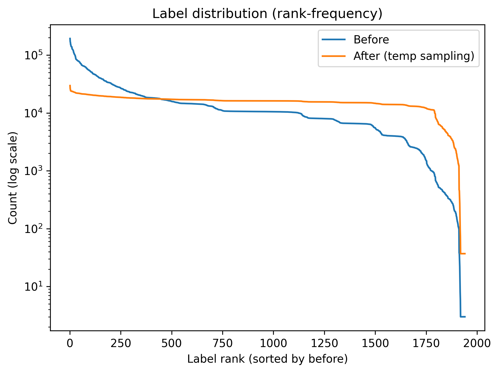

<div align="center">

# LIBE: Language Identification through Representation Learning

[](https://huggingface.co/cafoscari-nlp/LIBE)
[](https://huggingface.co/spaces/roccot/LIBE)
[](https://osf.io/2zhct/)

Code and data for *"Representation Learning Enables Language Identification
in Zero- and Few-Shot Settings"* (TACL, 2026, to appear).

</div>

## Description

LIBE identifies languages by embedding input texts and natural-language
descriptions of languages into a shared semantic space, and retrieving the
most similar descriptions. A bi-encoder maps both input sentences and
descriptions of candidate languages into the same vector space; at inference
time, candidate languages are ranked by cosine similarity. This formulation
supports data-efficient learning and the addition of new candidate languages
through their descriptions. An optional cross-encoder re-ranking stage
improves discrimination in ambiguous or low-resource cases.

The released model is based on [LaBSE](https://huggingface.co/sentence-transformers/LaBSE)
and was trained on 10 million sentences from GlotLID-C. It supports language
identification over a candidate inventory of more than 1,800 languages.

## Resources

| Resource | Link |
|---|---|
| 📄 Paper | Rocco Tripodi, *Representation Learning Enables Language Identification in Zero- and Few-Shot Settings*, Transactions of the Association for Computational Linguistics, 2026 (to appear) |
| 🤗 Model | <https://huggingface.co/cafoscari-nlp/LIBE> |
| 🤗 Demo | <https://huggingface.co/spaces/roccot/LIBE> |
| 🗄️ Large files & weights | [OSF project](https://osf.io/2zhct/) |

## Abstract

Language Identification (LID) is a key component of multilingual NLP pipelines and multilingual corpus construction. LID errors can create spurious text-language associations, harming downstream model quality, especially for low-resource languages and fine-grained taxonomies involving closely related languages and dialects. We propose LIBE, a representation-based approach that embeds input texts and natural-language descriptions into a shared semantic space with a bi-encoder, enabling LID via similarity search. This formulation supports data-efficient learning and the addition of new languages through their descriptions. To improve discrimination in ambiguous or low-resource cases, we also introduce an optional cross-encoder re-ranking stage. Across multiple benchmarks, LIBE achieves competitive performance with strong LID systems when initialized from pretrained multilingual encoders, while requiring substantially less task-specific LID supervision in several adaptation settings. The hybrid bi-encoder-cross-encoder formulation further improves robustness in challenging open-set scenarios, achieving up to 90% F1 with as few as five labeled examples. Code and data are available at <https://github.com/cafoscari-nlp/LIBE>.

## Repository structure

```
├── environment.yml              # conda environment (Python 3.11)
├── train_biencoder.py           # train the bi-encoder
├── train_cross_ecnoder.py       # train the cross-encoder variant
├── eval.py / test.py            # evaluation
├── speed_test.py                # inference speed benchmark
├── quick_start.py               # minimal inference example (single sentence)
├── data/
│   ├── MCS-350/                 # small eval sets (k = 1, 3, 5)
│   ├── udhr-lid/                # small eval sets (k = 1, 3, 5, full)
│   ├── flores200/               # → on OSF (see below)
│   └── glotlid-corpus/          # → on OSF (see below)
├── models/
│   └── GlotLID-10M_desc/        # trained bi-encoder (config + tokenizer; weights on OSF)
├── plots/
└── resources/                   # → on OSF (see below)
```

## Setup

```bash
conda env create -f environment.yml
conda activate langRepNew
```

## Usage

### Try the demo

The easiest way to try LIBE is the interactive app on
[Hugging Face Spaces](https://huggingface.co/spaces/roccot/LIBE): enter a
sentence to view the predicted language and the highest-scoring candidates.

### Use the model from Hugging Face

The bi-encoder checkpoint is also available on
[Hugging Face](https://huggingface.co/cafoscari-nlp/LIBE):

```bash
pip install sentence-transformers
```

```python
from sentence_transformers import SentenceTransformer, util

model = SentenceTransformer("cafoscari-nlp/LIBE")

# These two descriptions illustrate the API only.
# For full LIBE inference, use the project's complete description inventory
# (see quick_start.py and resources/WorldsLangs.tsv).
descriptions = {
    "eng": "English is a West Germanic language.",
    "ita": "Italian is a Romance language.",
}
labels = sorted(descriptions)
description_embeddings = model.encode(
    [descriptions[label] for label in labels],
    convert_to_tensor=True,
    normalize_embeddings=True,
)

text = "Questa è una frase in italiano."
query_embedding = model.encode(
    [text], convert_to_tensor=True, normalize_embeddings=True
)

hits = util.semantic_search(
    query_embedding, description_embeddings, top_k=len(labels)
)[0]

for hit in hits:
    print(f"{labels[hit['corpus_id']]}: {hit['score']:.4f}")
```

### Quick start (local)

1. Download the checkpoint and the language-description resource from OSF
   (direct links in the table above) and place them at those paths in the repository:

```bash
curl -fL --create-dirs "https://osf.io/download/6a1ffc18a7eb391ce3ffb8f0" -o models/GlotLID-10M_desc/model.safetensors
curl -fL --create-dirs "https://osf.io/download/69889a9f5fd86b3c4b904c67" -o resources/WorldsLangs.tsv
```

2. Identify the language of a sentence:

```bash
python quick_start.py
# Пур халӑх та тивӗҫлӗ тата хисепре пурӑнма пӗр тан праваллӑ.
# <score>  chv

python quick_start.py --sentence "The will of the people shall be the basis of the authority of government;" --top-k 5
```

## Large files on OSF

Large data files and model weights are **not** stored in this repository.
They are available on the [OSF project page](https://osf.io/2zhct/)

| File | Size | Link |
|---|---|---|
| `data/glotlid-corpus/train_sampled_10M.tsv` | 1.8 GB | [OSF](https://osf.io/2zhct/files/osfstorage/6a71eecc47da1b4e4fb921c0) |
| `data/glotlid-corpus/train_sampled_30M.tsv.zip` | 2.8 GB | [OSF](https://osf.io/2zhct/files/osfstorage/6989b954f2c8ea0598dfc6f3) |
| `models/GlotLID-10M_desc/model.safetensors` | 1.8 GB | [OSF](https://osf.io/2zhct/files/osfstorage/6a1ffc18a7eb391ce3ffb8f0) |
| `data/flores200/LID.tsv` | 42 MB | [OSF](https://osf.io/2zhct/files/osfstorage/6989b9f59d26780efdc72ce3) |
| `data/flores200/LID.ft` | 44 MB | [OSF](https://osf.io/2zhct/files/osfstorage/6989b9a187d53a80f2dfc61f) |
| `data/flores200/NLLB.tsv` | 41 MB | [OSF](https://osf.io/2zhct/files/osfstorage/6989b9bbcb45daa96cdfc7f0) |
| `data/flores200/NLLB.ft` | 43 MB | [OSF](https://osf.io/2zhct/files/osfstorage/6989ba0d861c86e3d2c72b81) |
| `data/flores200/CLD3.tsv` | 18 MB | [OSF](https://osf.io/2zhct/files/osfstorage/6989b9dabdd9eb9498e24f80) |
| `data/flores200/CLD3.ft` | 19 MB | [OSF](https://osf.io/2zhct/files/osfstorage/6989b9cb65ba7eba46dfca6b) |
| `data/MCS-350/MCS-350_without-k.tsv` | 49 MB | [OSF](https://osf.io/2zhct/files/osfstorage/6988aac60c4fa09046c728a0) |
| `resources/WorldsLangs.tsv` | 24 MB | [OSF](https://osf.io/2zhct/files/osfstorage/69889a9f5fd86b3c4b904c67) |

## Label distribution

Rank–frequency of language labels in the GlotLID training corpus: the raw corpus
(`Before`) is heavily long-tailed; temperature-based sampling (`After`) flattens the
distribution.



## Citation

If you use LIBE in your work, please cite:

```bibtex
@article{tripodi-2026-libe,
  author  = {Tripodi, Rocco},
  title   = {Representation Learning Enables Language Identification in Zero- and Few-Shot Settings},
  journal = {Transactions of the Association for Computational Linguistics},
  year    = {2026},
  note    = {To appear}
}
```

## License

This LIBE model checkpoint is licensed under the [Creative Commons Attribution 4.0 International license (CC BY 4.0)](https://creativecommons.org/licenses/by/4.0/).

The application code and accompanying data may be subject to separate licenses; consult their respective repositories and license notices.
